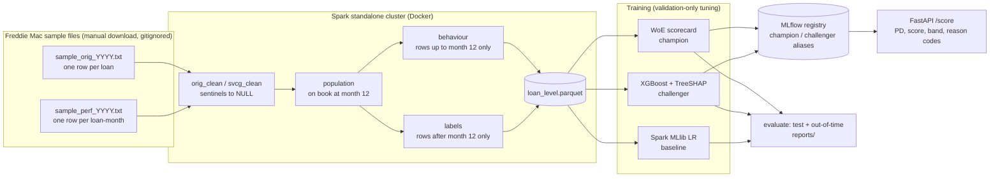

# Behavioural mortgage PD: WoE scorecard vs XGBoost, with explainability

A bank-style credit-risk model built end to end on the **Freddie Mac Single-Family Loan-Level Dataset**:
Spark SQL feature engineering, a points-based WoE scorecard as the champion, an XGBoost challenger with
SHAP reason codes, a Spark MLlib baseline, out-of-time validation, MLflow model registry and a
Dockerised FastAPI scoring service.

**Question answered:** for a performing fixed-rate mortgage at its 12th payment, what is the probability
of going 90+ days past due (or a credit event) in the next 24 months — and how much accuracy does an
interpretable scorecard give up against gradient boosting?

## Results

Rendered from `reports/results.json` by `scripts/render_results.py` — no number below is typed by hand.

<!-- RESULTS:START -->
### Data (observation population at month 12)

| vintage | loans on book, not in default | outcome observed | defaults (months 13-36) | default_rate |
|---|---|---|---|---|
| 2010 | 46143 | 46143 | 493 | 1.07% |
| 2011 | 43737 | 43737 | 369 | 0.84% |
| 2012 | 46256 | 46256 | 325 | 0.70% |
| 2013 | 46829 | 46829 | 304 | 0.65% |
| 2014 | 44944 | 44944 | 375 | 0.83% |
| 2015 | 45363 | 45363 | 398 | 0.88% |
| 2016 | 46976 | 46976 | 420 | 0.89% |

Splits: train 136,745 / validation 45,582 / in-time test 45,582 (vintages 2010-2014) and out-of-time 92,339 (2015-2016). Loans with an incomplete outcome window excluded: 0.

### Discrimination and calibration

| sample | model | ROC-AUC | Gini | KS | avg precision | Brier | observed default rate | mean PD | observed / predicted |
|---|---|---|---|---|---|---|---|---|---|
| In-time test | WoE scorecard | 0.885 | 0.770 | 0.625 | 0.150 | 0.00749 | 0.82% | 0.84% | 0.98 |
| In-time test | XGBoost | 0.886 | 0.772 | 0.634 | 0.165 | 0.00740 | 0.82% | 0.83% | 0.98 |
| In-time test | Spark MLlib LR | 0.882 | 0.764 | 0.607 | 0.179 | 0.00736 | 0.82% | 0.83% | 0.99 |
| Out-of-time | WoE scorecard | 0.837 | 0.673 | 0.511 | 0.155 | 0.00807 | 0.89% | 0.55% | 1.62 |
| Out-of-time | XGBoost | 0.853 | 0.706 | 0.544 | 0.174 | 0.00793 | 0.89% | 0.56% | 1.57 |
| Out-of-time | Spark MLlib LR | 0.837 | 0.674 | 0.517 | 0.172 | 0.00798 | 0.89% | 0.65% | 1.36 |

**Cost of interpretability** (XGBoost Gini minus scorecard Gini): 0.002 on the in-time test, 0.033 out of time.

### Key findings

- **Interpretability is almost free in time, not out of time.** On the in-time test the scorecard and XGBoost are nearly tied (Gini 0.770 vs 0.772); on the 2015-2016 vintages XGBoost degrades less (Gini 0.673 vs 0.706).
- **Both models under-predict out of time.** In time, mean PD matches the observed default rate (0.84% vs 0.82% for the scorecard). Out of time the observed rate is 0.89% against a mean PD of 0.55% (scorecard) and 0.56% (XGBoost). The largest characteristic shift is `orig_interest_rate` (PSI 0.70). Average note rates were lower out of time (2015: 3.97%, 2016: 3.78%) than across development (4.22% on average), and the lowest-rate development vintages (2012: 3.75% rate, 0.70% defaults, 2013: 3.92% rate, 0.65% defaults) were also the two safest, so the absolute rate partly encodes the vintage. The production response would be recalibration on recent vintages and replacing the absolute rate with the rate spread. That change is deliberately **not** made here: modifying the model after seeing out-of-time results would contaminate the out-of-time test.
- **The cut-off drifts with it.** The scorecard cut-off fixed on validation at 90% approval approves 95.8% of the out-of-time book, while still declining 42.1% of its defaults.
- **Ranking holds out of time.** Default rates still rise monotonically across bands A-G (table below), so recalibration rather than redevelopment is indicated.

### Score stability (PSI)

| model | comparison | psi |
|---|---|---|
| WoE scorecard | train_vs_test | 0.0004 |
| WoE scorecard | train_vs_oot | 0.0793 |
| XGBoost | train_vs_test | 0.0006 |
| XGBoost | train_vs_oot | 0.0536 |
| Spark MLlib LR | train_vs_test | 0.0003 |
| Spark MLlib LR | train_vs_oot | 0.0798 |

Train-vs-test PSI is near zero by construction (random split); train-vs-OOT is the meaningful check (< 0.10 stable, 0.10-0.25 monitor, > 0.25 shift).

Largest feature shifts, train vs OOT:

| feature | psi_train_vs_oot |
|---|---|
| orig_interest_rate | 0.7026 |
| upb_paydown_ratio | 0.2361 |
| orig_cltv | 0.1728 |
| mi_pct | 0.0542 |
| orig_upb | 0.0537 |

### Decision cut-off (fixed on validation at 90% approval)

| model | sample | cut-off score | approval rate | bad rate approved | bad rate declined | share of bads declined |
|---|---|---|---|---|---|---|
| WoE scorecard | test | 607 | 90.0% | 0.34% | 5.14% | 62.3% |
| WoE scorecard | oot | 607 | 95.8% | 0.54% | 8.92% | 42.1% |
| XGBoost | test | 605 | 90.1% | 0.36% | 4.99% | 60.2% |
| XGBoost | oot | 605 | 95.6% | 0.53% | 8.59% | 42.8% |

### Scorecard risk bands, out-of-time

| band | n | share | defaults | default_rate | mean_pd |
|---|---|---|---|---|---|
| A | 49316 | 53.4% | 91 | 0.18% | 0.12% |
| B | 22357 | 24.2% | 138 | 0.62% | 0.35% |
| C | 13091 | 14.2% | 170 | 1.30% | 0.69% |
| D | 4987 | 5.4% | 119 | 2.39% | 1.35% |
| E | 1438 | 1.6% | 69 | 4.80% | 2.70% |
| F | 549 | 0.6% | 45 | 8.20% | 5.48% |
| G | 601 | 0.7% | 186 | 30.95% | 23.00% |

### Segment check at the scorecard cut-off, out-of-time

Non-protected segments only - the data has no sex, age or race (see model card).

| segment | value | n | default_rate | approval_rate | bad_rate_approved | auc |
|---|---|---|---|---|---|---|
| first_time_homebuyer_flag | Missing | 2 | 0.00% | 100.0% | 0.00% | n/a |
| first_time_homebuyer_flag | N | 77459 | 0.82% | 95.9% | 0.50% | 0.834 |
| first_time_homebuyer_flag | Y | 14878 | 1.23% | 95.2% | 0.70% | 0.842 |
| num_borrowers_group | 1 | 45994 | 1.23% | 93.3% | 0.70% | 0.818 |
| num_borrowers_group | 2+ | 46345 | 0.54% | 98.3% | 0.38% | 0.835 |
| occupancy_status | I | 7561 | 0.56% | 94.2% | 0.32% | 0.825 |
| occupancy_status | P | 81645 | 0.94% | 95.9% | 0.57% | 0.837 |
| occupancy_status | S | 3133 | 0.38% | 97.5% | 0.26% | 0.880 |

### Scorecard characteristics

| characteristic | IV (train) |
|---|---|
| months_since_last_dlq | 1.015 |
| credit_score | 0.831 |
| dlq_at_obs | 0.764 |
| upb_paydown_ratio | 0.745 |
| orig_interest_rate | 0.671 |
| orig_cltv | 0.668 |
| orig_dti | 0.568 |
| rate_spread_at_orig | 0.544 |
| excess_paydown_ratio | 0.358 |
| num_borrowers_group | 0.172 |
| mi_pct | 0.040 |
| property_state | 0.039 |

Regularisation C = 10.0 (chosen on validation). Full points table: `reports/scorecard_points.csv`.

### Illustrative expected credit loss (not an SLFRS 9 / IFRS 9 estimate)

ECL = PD x LGD x EAD on the OOT book. LGD = 32.0% (exposure-weighted realised loss on 1,541 credit-event terminations in development vintages; median 30.8%). EAD = balance at month 12. PD is the 24-month model PD. Result: ECL 0.165% of EAD. Amounts are USD for US mortgages; this illustrates the mechanics only - no staging, lifetime PD or forward-looking scenarios.

<!-- RESULTS:END -->

Figures: `reports/figures/performance_test.png`, `reports/figures/performance_oot.png`
(ROC, precision-recall, reliability), `reports/figures/score_distribution_test.png`,
`reports/figures/xgboost_shap_importance.png`.

## Architecture



## Quickstart

Prerequisites: Docker Desktop (≥ 8 GB memory for the VM), GNU make, bash, [uv](https://docs.astral.sh/uv/).

1. **Get the data.** Register (free) for Freddie Mac's Clarity Data Intelligence and open the
   [SFLLD download page](https://claritydownload.fmapps.freddiemac.com/CRT/). Download the **sample**
   files `sample_2010.zip` … `sample_2016.zip` into `data/downloads/`. Registering is how you accept
   Freddie Mac's terms — read them; the data must not be redistributed.
2. **Run:**

```bash
make fetch
```

```bash
make up
```

```bash
make pipeline
```

```bash
make serve
```

```bash
make smoke
```

`make test` runs the full test suite (including the Spark leakage tests) inside the pipeline image;
`make test-local` runs the non-Spark tests on the host. `make system-test` runs the whole pipeline and
the API on seeded synthetic data (outputs in `data/synthetic/`, never in `reports/`).

UIs: Spark master <http://localhost:8080>, MLflow <http://localhost:5000>,
API docs <http://localhost:8000/docs>.

**Windows:** clone into a path with only ASCII characters (e.g. `C:\dev\credit-default-risk-modelling`).
Docker BuildKit rejects non-ASCII characters in the build-context path, and Python's editable install
cannot read `.pth` files containing them. Run the `make` targets from Git Bash.

### Scoring API

`POST /score?model=scorecard|xgboost` with the loan's features at month 12. Example
(synthetic loan — `src/creditrisk/api/schemas.py`):

```bash
curl -s -X POST "http://localhost:8000/score?model=scorecard" -H "Content-Type: application/json" -d '{"loan_id":"example-001","features":{"credit_score":682,"orig_ltv":90,"orig_dti":44,"occupancy_status":"P","dlq_at_obs":1,"n_months_dlq30_12m":2}}'
```

The response holds `pd`, `score`, `band` (A–G) and up to four `reason_codes`, each with the
feature, plain-English reason, the input value and its impact (points lost for the scorecard, SHAP
log-odds for XGBoost). Unknown fields, out-of-range values and invalid codes are rejected with 422.

## Key design decisions

| Decision | Why | ADR |
|---|---|---|
| Freddie Mac data, behavioural PD at month 12 | Terms allow publishing non-commercial research results; real dates allow a true out-of-time test; default definition close to 90 DPD | [0001](docs/decisions/0001-dataset-and-behavioural-design.md) |
| Spark SQL for aggregation, single-node XGBoost | ~tens of millions of loan-months need Spark; the one-row-per-loan table fits in memory and exact TreeSHAP needs the native booster | [0002](docs/decisions/0002-spark-for-aggregation-single-node-xgboost.md) |
| Stratified train/validation/test + out-of-time vintages | Tune on validation only, score test and OOT once; PSI on OOT is the real stability check | [0003](docs/decisions/0003-validation-design.md) |
| Custom monotonic WoE binning, IV + correlation selection, sign-checked LR | Auditable, testable, no solver dependency; every coefficient has the expected sign | [0004](docs/decisions/0004-woe-scorecard.md) |
| No postal code / MSA; fairness limited to non-protected segments | Fine geography is a protected-class proxy; the data has no demographics | [0005](docs/decisions/0005-protected-attributes-and-geography.md) |
| MLflow registry with champion/challenger aliases | Promotion is an alias change; the API loads by alias | [0006](docs/decisions/0006-mlflow-registry-and-serving.md) |

**Leakage guard.** Features are built only from performance rows up to the observation month; labels
only from rows after it. `tests/test_leakage.py` rewrites every record after month 12 (forcing all
loans into serious delinquency) and asserts every feature is unchanged while labels change, and fails
if any feature SQL references a label column.

**Score scaling.** score = offset + factor × ln(good:bad odds), factor = 20 / ln 2 = 28.854,
offset = 600 − 28.854 × ln 50 = 487.123. 50:1 odds score 600; every 20 points doubles the odds.
XGBoost PDs are mapped to the same scale.

## Data and licence

Code: MIT ([LICENSE](LICENSE)). Data: Freddie Mac Single-Family Loan-Level Dataset, used under
[Freddie Mac's terms](https://capitalmarkets.freddiemac.com/crt/docs/pdfs/fre_terms_conditions_sflld.pdf),
which allow academic or research use and publishing non-commercial results that cannot be used to
recreate the data or identify individuals. **No raw data, loan-level derived data or individual loan
records are in this repository**; `reports/` holds aggregate tables and figures only. Tests use
seeded synthetic data that reproduces the public file layout. Data issues and their handling:
[docs/data_issues.md](docs/data_issues.md).

## Limitations

- No protected attributes in the data, so no protected-class fairness test; the segment check is
  descriptive only ([model card](docs/model_card.md)).
- US conforming mortgages purchased by Freddie Mac — a selected, prime-skewed population; accepted
  loans only, no reject inference.
- Out-of-time sample is 2015–2016 vintages; outcome windows end before COVID-19 forbearance.
- 24-month behavioural PD is not a 12-month or lifetime IFRS 9 PD; the ECL section is illustrative
  (SLFRS 9 in Sri Lanka follows IFRS 9 and would need staging, SICR and forward-looking scenarios).
- Low default rates make estimates in the best risk bands noisy.
- Out of time both models rank well but under-predict PD (see Key findings) — fit for
  rank-ordering, not for PD-level use without recalibration.

## What I'd do next

- Fix the out-of-time under-prediction properly: drop the absolute note rate in favour of the rate
  spread, add a recalibration layer fitted on the most recent vintages, and confirm on a vintage
  not yet used (e.g. 2017) so the out-of-time test stays clean.
- Survival / multi-horizon PD to produce 12-month and lifetime PDs for an IFRS 9 / SLFRS 9 staging
  exercise, with macro scenarios.
- Monotonic constraints on XGBoost to close the gap between accuracy and explainability.
- Champion/challenger monitoring job: monthly PSI, band back-testing, alerting.
- A feature store so the API computes behavioural features itself from servicing data.
- A proper fair-lending review on data that includes applicant demographics.

## Repository layout

```
configs/            pipeline.yaml (all parameters), synthetic.yaml (system test)
src/creditrisk/
  features/sql/     Spark SQL, one file per step
  features/         catalogue, Spark session, build orchestration
  scorecard/        monotonic WoE binning, scorecard model
  challenger/       XGBoost + TreeSHAP
  baseline/         Spark MLlib logistic regression
  evaluation/       metrics (AUC, Gini, KS, PSI, bands, cut-offs)
  api/              FastAPI app, request/response schemas
  train.py evaluate.py tracking.py cli.py
tests/              unit, Spark leakage and API contract tests (synthetic data)
docs/               model card, data issues, ADRs
reports/            aggregate results from the last run
```
